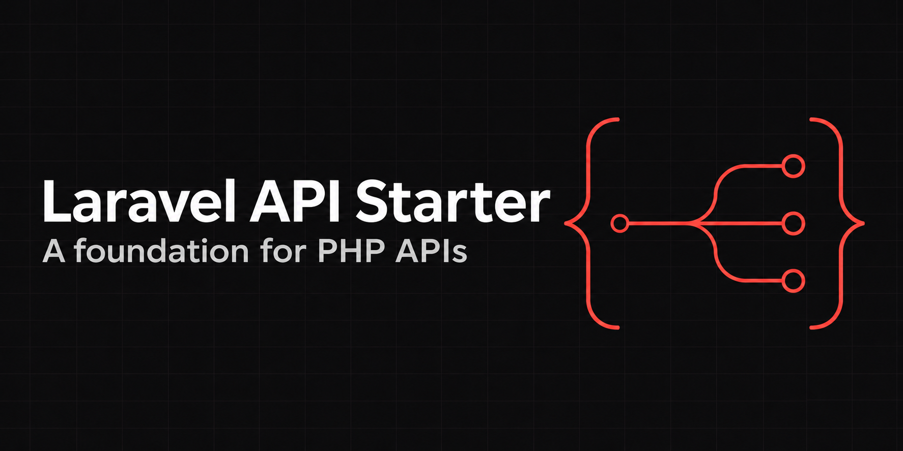
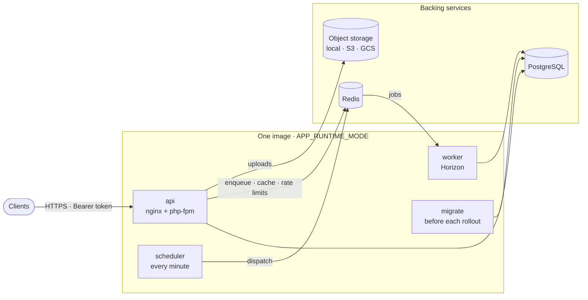

# Laravel API Starter

[](https://github.com/jaylordibe/laravel-api-starter/actions/workflows/test.yml)
[](https://github.com/jaylordibe/laravel-api-starter/actions/workflows/security.yml)
[](LICENSE)

A template for headless JSON APIs on Laravel 13 and PHP 8.5. Fork it to start a
new API with authentication, authorization, queues, health checks and a
production container already decided, each decision written down next to the
code and checked by CI wherever a machine can check it.

**[Quick start](#quick-start)** · **[What's included](#whats-included)** ·
**[Guardrails](#enforced-not-just-documented)** · **[Architecture](#architecture)** ·
**[Production](#going-to-production)** · **[Docs](#documentation)**

## Why this starter

`laravel new` gives you a framework. It leaves open the decisions that make an
API safe to run: how sign-in resists guessing without locking out a shared office
IP, whose records a query may return, what happens to a queued job when a
container stops mid-run, which configuration is too dangerous to boot with, and
the order a deploy must follow. This starter makes those decisions up front, and
every new resource follows one layered pattern, so the tenth endpoint looks like
the first.

**A good fit for**

- Mobile and web backends with real users, roles and permissions
- APIs with background work: email, exports, imports, scheduled jobs
- Teams that want one reviewed baseline for every new Laravel API

**Probably more than you need for**

- Prototypes and throwaway demos
- Full-stack Blade or Inertia apps. This is a headless JSON API
- Anything a plain `laravel new` already covers

## Quick start

**Prerequisites:** Git, a Bash shell and Docker with Compose. PHP 8.5, Composer,
PostgreSQL and Redis all run in containers, so none of them is needed on the host.

1. Create your own repository with **Use this template** on GitHub, or clone this one:

   ```bash
   git clone https://github.com/jaylordibe/laravel-api-starter.git my-api
   cd my-api
   ```

2. Start the stack. The first run creates `.env` from `.env.example`, installs
   dependencies, migrates and seeds the database, and generates the app and
   Passport keys:

   ```bash
   ./start.sh fresh
   ```

3. Check that the API is ready (database and Redis both reachable):

   ```bash
   curl http://localhost:8000/api/health/ready
   ```

   ```json
   {"success":true,"message":"Service is ready.","status":"ready","checks":{"database":true,"redis":true}}
   ```

> [!WARNING]
> `./start.sh fresh` deletes `.env`, `vendor` and the local database data, and
> uses `sudo` to do it. `./start.sh reset` re-creates the local database. Plain
> `./start.sh` keeps everything. The seeder creates test users with a published
> password, so use it locally only, never in production.

| Service | Address |
|---|---|
| API | [localhost:8000](http://localhost:8000) |
| API docs (generated OpenAPI) | [localhost:8000/docs/api](http://localhost:8000/docs/api) |
| pgAdmin (development database) | [localhost:8001](http://localhost:8001) · PostgreSQL on port 5436 |
| pgAdmin (test database) | [localhost:8002](http://localhost:8002) · PostgreSQL on port 5435 |

These are the default host ports. If another project already holds one, set its
override (`APP_PORT`, `FORWARD_DB_PORT`, ...) in `.env`; `.env.example` lists them.
Running the production image instead of the local stack is covered in
[`DEPLOYMENT.md`](DEPLOYMENT.md#1-runtime-commands).

### Commands

| Command | What it does |
|---|---|
| `./start.sh` / `./stop.sh` | Start or stop the local stack, keeping its data |
| `./test.sh` | The full test suite, in parallel |
| `./test.sh <Filter> <path/to/Test.php>` | One test |
| `./test-pipeline.sh` | Exactly what CI runs |
| `php artisan app:format` / `--check` | Format the code / check it without writing |
| `php artisan app:generate-resource` | Scaffold a new CRUD resource in the standard pattern |
| `php artisan app:check-config` | Validate the effective runtime configuration |
| `php artisan migrate:status` | See which migrations have run |

Artisan commands run in the container:

```bash
docker exec -it laravel-api bash -c "php artisan <command>"
```

## What's included

**Identity and sessions**

- Laravel Passport bearer tokens. Sign-in accepts an email or a username and gives the same generic error for a wrong password or an unknown user, so it reveals no accounts.
- Sign-in is limited to 5 attempts a minute per identifier and IP, with no lockout a stranger can trigger.
- Sign-up, verification by signed link, resend, forgot and reset password. A reset signs out every session.
- Changing your password requires the current one and signs out your other sessions. An email change is confirmed from the new address before it applies.
- Sign out of this device, or of every device.

**Authorization**

- Roles and permissions with Spatie `laravel-permission`. Every permission is an enum case registered as a Gate; a permission an environment hasn't synced yet denies (403) instead of crashing.
- Ownership scoped inside repository queries, so another user's record answers exactly like a missing one.
- Layered rate limits: a stolen token, one user across tokens, and one IP each hit their own ceiling.

**Data**

- PostgreSQL end to end: migrations, tests and CI. A hardened `mysql` connection is kept for a fork that must use MySQL.
- `BaseModel` with soft deletes and audit stamps (`created_by`, `updated_by`, `deleted_by`).
- One query envelope for every list: pagination, sorting and relations, each opted in per request, with a fixed default order.
- Money as `Brick\Math\BigDecimal`, never a float. Activity log with Spatie `laravel-activitylog`.

**Background work**

- Redis queues through Horizon, with a tracked job status a client can poll (`GET /api/job-statuses/{id}`).
- Workers that finish their current job before stopping, verified in CI.
- Spreadsheet import and export (PhpSpreadsheet), and PDF and image rendering (Snappy).

**Operations**

- Liveness at `/up`, readiness at `/api/health/ready` (database and Redis).
- A startup configuration check in every container ([below](#enforced-not-just-documented)).
- OpenAPI documentation generated by Scramble from the code: open locally, behind Basic auth elsewhere, never served in production.
- One production image with separate `api`, `worker`, `migrate` and `scheduler` runtime modes, and `publish-image.yml` to build, scan, attest and push it to GHCR. It deploys nothing; your platform pulls the image.

**AI clients**

- A Model Context Protocol endpoint at `/api/mcp`. A client connects with only that URL, the user signs in and approves it on the API's own pages (OAuth 2.1 with PKCE through Passport), and the client then acts as that user. See [`docs/mcp.md`](docs/mcp.md).

<details>
<summary><b>API surface</b>: every route, grouped by who may call it</summary>

All routes are under `/api`. The generated OpenAPI document is the full specification.

**Public**

- `GET /health/ready`: readiness.
- `GET /app-versions/latest`: the client update check.
- `POST /auth/sign-in`: returns `{ token, expiresIn }`.
- `POST /users/sign-up`, `GET /email/verify/{id}`, `POST /email/verification-notification`: sign-up and email verification.
- `POST /email/change/confirm`: confirms an email change from the new address.
- `POST /forgot-password`, `POST /reset-password`: password reset.

**Authenticated**

- `POST /auth/sign-out`, `POST /auth/sign-out-all`.
- `GET|PUT|DELETE /users/auth`: your own account; `PUT /users/auth/{username,email,password}`, `DELETE /users/auth/email/pending`, `POST /users/auth/profile-image`.
- `POST|GET|PUT|DELETE /device-tokens`: your own push tokens.
- `GET /app-versions`, `GET /app-versions/{id}`, `GET /job-statuses/{id}`, `GET|POST /activity-logs`, `GET /constants/*`.

**Behind a permission**

- `POST|GET|PUT|DELETE /users`, `GET /users/{id}`: user management; `PUT /users/{id}/password` resets another user's password (admins only).
- `POST|PUT|DELETE /app-versions`: release management.

</details>

## Enforced, not just documented

A rule that lives only in a README is a rule nothing fails on. Where an
assumption can be checked by a machine, this repository checks it, as early as it
can be caught.

| Layer | What it refuses | Where |
|---|---|---|
| **Format** | Code that drifts from the house style | `php artisan app:format --check` in CI (never Pint) |
| **Feature tests** | Behaviour that breaks under real conditions | In parallel against real PostgreSQL, one database per worker: auth, access control, ownership scoping, the list query envelope, email change, password reset, health |
| **Startup check** | Unsafe production configuration, before a request is served | `app:check-config` at container start: no `APP_KEY`, `APP_DEBUG` on, a database link without TLS, Redis TLS without peer verification, a `file` cache across replicas, a public upload disk, a Horizon timeout that would run jobs twice, missing Passport keys. See [`CheckConfigCommand`](app/Console/Commands/CheckConfigCommand.php) |
| **Image checks** | An image that is unpinned, vulnerable or wired wrong | The base image is pinned by digest; the built image is scanned with Trivy, booted in each runtime mode, and its worker is shown to drain in-flight jobs on `SIGTERM`. See [`test.yml`](.github/workflows/test.yml) |
| **Security gates** | Known-vulnerable dependencies and regressions | `composer audit` blocking on high and critical (an exception needs a reason and a review date, and the gate flags it once stale), a Trivy filesystem scan, and a weekly authenticated OWASP ZAP scan of every API operation. See [`security.yml`](.github/workflows/security.yml) and [`security-dast.yml`](.github/workflows/security-dast.yml) |

## Architecture



Every resource takes the same path, and `AppVersion` is the cleanest reference:

```text
Route  →  Controller  →  Request  →  Service  →  Repository  →  Model
          thin          validates,   all business  all database   extends
                        builds Data  rules         access         BaseModel
       ←  Resource shapes the JSON
```

Controllers never branch on a result: a service throws `BadRequestException` and
every failure has the same `{"success": false, "message": …}` shape. The
reasoning behind each layer is in
[`docs/engineering-conventions.md`](docs/engineering-conventions.md#architecture--the-layered-request-pipeline).

## Building on it

**Adding a resource.** `php artisan app:generate-resource` scaffolds the
controller, requests, data objects, service, repository, model, resource,
migration, factory and tests in the standard pattern; `AppVersion` is the
working reference.

**Conventions.** [`AGENTS.md`](AGENTS.md) holds the repository's rules in short
form (the pipeline, errors, money, authorization, migrations), and
[`docs/engineering-conventions.md`](docs/engineering-conventions.md) holds the
reasoning behind each one. Worksheets for designing a new API contract and
database schema are in [`docs/`](docs/).

**Forking.** This is a template, so a defect here is inherited by every fork.
Replace the **Consumers** table in `AGENTS.md` with your real clients before your
first contract change.

### Working with coding agents (optional)

[`AGENTS.md`](AGENTS.md) is the repository's truth for any coding agent:
canonical commands, high-risk paths, conventions and consumers. `CLAUDE.md`
imports it, and `.claude/` commits domain playbooks for auth, resources, tests,
background work, integrations and money. Contributors on
[Claude Code](https://code.claude.com) can add the
[Himoa](https://github.com/jaylordibe/himoa) plugin for a reviewed
requirement-to-diff workflow:

```text
/plugin marketplace add jaylordibe/himoa
/plugin install himoa@jaylordibe
```

None of this is needed to build, run or test the API.

## Going to production

Start with [`DEPLOYMENT.md`](DEPLOYMENT.md): runtime modes, the container,
database, Redis, storage, secrets, health checks, reverse proxies and the startup
check. A deploy runs, in order: **migrate → sync permissions → workers → API →
verify readiness**, as set out in
[§14](DEPLOYMENT.md#14-publishing-an-image-and-what-every-deployment-must-do).

<details>
<summary><b>Production checklist</b>: confirm these before the first real deploy</summary>

- [ ] `APP_KEY` and the Passport keys generated **once** per environment and injected as secrets. Regenerating them signs everyone out and makes encrypted data unreadable.
- [ ] `APP_DEBUG=false` and `APP_ENV=production`. The startup check refuses debug mode in production.
- [ ] The database link uses TLS (`DB_SSLMODE=require` at minimum; `verify-full` across an untrusted network).
- [ ] `CACHE_STORE=redis`, so locks and cache invalidation work across replicas.
- [ ] The upload disk is private (`s3` or `gcs`), served through signed URLs.
- [ ] Behind a load balancer, `TRUSTED_PROXIES` (comma-separated) names only the proxies that connect to the API, or `TRUST_ANY_PROXY=true` where nothing else can reach it. See [`DEPLOYMENT.md` §10](DEPLOYMENT.md#10-reverse-proxies).
- [ ] The API runs `APP_RUNTIME_MODE=api` and the worker runs `worker`; `all` is only for a single container.
- [ ] Something invokes `APP_RUNTIME_MODE=scheduler` every minute.
- [ ] The Passport personal access client created once (sign-in needs it).
- [ ] `UserSeeder` and `DatabaseSeeder` never run in production: they create test users with a published password.
- [ ] Backups of PostgreSQL scheduled, and a restore actually tested.

</details>

## Documentation

| Document | For |
|---|---|
| [`AGENTS.md`](AGENTS.md) | Repository rules, canonical commands and high-risk paths |
| [`DEPLOYMENT.md`](DEPLOYMENT.md) | The runtime contract any platform must satisfy |
| [Engineering conventions](docs/engineering-conventions.md) | The reasoning behind every rule |
| [MCP endpoint](docs/mcp.md) | Connecting MCP clients, the OAuth sign-in, adding a tool |
| [API contract worksheet](docs/api-contract.md) | Designing a new endpoint's contract |
| [Database design worksheet](docs/database-design.md) | Designing a new table |

## Stack

| Concern | Choice |
|---|---|
| Runtime | PHP 8.5 on the pinned [`jaylordibe/laravel-php`](https://hub.docker.com/r/jaylordibe/laravel-php) base image (nginx + php-fpm) |
| Framework | Laravel 13 |
| Data | PostgreSQL, Eloquent |
| Queues and cache | Redis, Laravel Horizon |
| Auth | Laravel Passport, Spatie `laravel-permission` |
| Request and response data | Spatie `laravel-data`, API Resources |
| Money | `brick/math` |
| Files | Laravel `Storage`: local, S3 and S3-compatible, Google Cloud Storage |
| Documents | PhpSpreadsheet, Snappy (PDF and images) |
| API docs | `dedoc/scramble`, generated from the code |
| MCP | `laravel/mcp`, with Passport as the authorization server |
| Scaffolding | [`laravel-resource-generator`](https://github.com/jaylordibe/laravel-resource-generator) |
| Testing | PHPUnit 12 with ParaTest, against real PostgreSQL |

## License

MIT. See [LICENSE](LICENSE).

This is an independent project built on Laravel. It is not affiliated with or
endorsed by the Laravel project.
