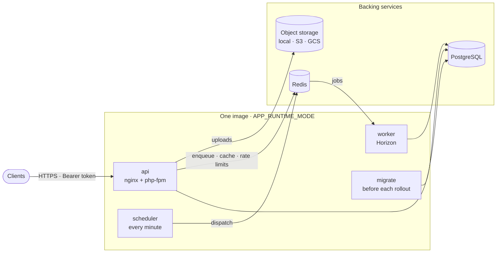

<div align="center">

# laravel-api

## A Laravel API you can fork into production.

A Laravel 13 / PHP 8.5 API template —<br>
authentication, authorization, background work and runtime safety already decided.

[](https://github.com/jaylordibe/laravel-api/actions/workflows/test.yml)
[](https://github.com/jaylordibe/laravel-api/actions/workflows/security.yml)
[](composer.json)
[](composer.json)
[](LICENSE)

**[Why](#why-laravel-api)** · **[Guardrails](#enforced-not-just-documented)** ·
**[Architecture](#architecture)** · **[What's&nbsp;included](#whats-included)** ·
**[Quick&nbsp;start](#quick-start)** · **[Docs](#documentation)**

</div>

---

## Why laravel-api

`laravel new` gives you a framework. It leaves open the decisions that make an
API safe to run: how sign-in resists guessing without locking out a shared office
IP, whose records a query may return, what happens to a queued job when a
container stops mid-run, which configuration is too dangerous to boot with, and
the order a deploy must follow.

laravel-api makes those decisions up front, writes the reasoning down next to the
code, and has a machine check every one it can. Every new resource then follows
one layered pattern, so the tenth endpoint looks like the first.

**A good fit for**

- Mobile and web backends with real users, roles and permissions
- APIs with background work: email, exports, imports, scheduled jobs
- Teams that want one reviewed baseline for every new Laravel API

**Probably more than you need for**

- Prototypes and throwaway demos
- Full-stack Blade or Inertia apps — this is a headless JSON API
- Anything a plain `laravel new` already covers

## Enforced, not just documented

A rule that lives only in a README is a rule nothing fails on. Where an
assumption can be checked by a machine, this repository checks it, as early as it
can be caught.

```text
format check  →  feature tests  →  startup config check  →  image checks  →  security gates
  (CI)          (real Postgres)     (every container)        (CI)            (every PR + weekly)
```

| Layer | What it refuses | Where |
|---|---|---|
| **Format** | Code that drifts from the house style | `php artisan app:format --check` in CI (never Pint) |
| **Feature tests** | Behaviour that breaks under real conditions | Run in parallel against real PostgreSQL, one database per worker — auth, access control, ownership scoping, the list query envelope, email change, password reset, health |
| **Startup check** | Unsafe production configuration, before a request is served | `app:check-config` runs at container start: no `APP_KEY`, `APP_DEBUG` on, a database link without TLS, Redis TLS without peer verification, a `file` cache across replicas, a public upload disk, a Horizon timeout that would run jobs twice, missing Passport keys — [`CheckConfigCommand`](app/Console/Commands/CheckConfigCommand.php) |
| **Image checks** | An image that is unpinned, vulnerable or wired wrong | The base image must be pinned by digest; the built image is scanned with Trivy, booted in each runtime mode, and its worker is shown to drain in-flight jobs on `SIGTERM` — [`test.yml`](.github/workflows/test.yml) |
| **Security gates** | Known-vulnerable dependencies and regressions | `composer audit` blocking on high and critical (with documented, dated exceptions), a Trivy filesystem scan, and a weekly authenticated OWASP ZAP scan of every API operation — [`security.yml`](.github/workflows/security.yml), [`security-dast.yml`](.github/workflows/security-dast.yml) |

The dependency gate deserves a note: `composer audit` can't accept a single
advisory, so an all-or-nothing gate meets one unfixable finding and gets deleted.
Here an exception is allowed only with a reason and a review date, and the gate
complains when one goes stale.

## Architecture



**Every resource takes the same path.** No alternate patterns, and `AppVersion`
is the cleanest reference:

```text
Route  →  Controller  →  Request  →  Service  →  Repository  →  Model
          thin          validates,   all business  all database   extends
                        builds Data  rules         access         BaseModel
       ←  Resource shapes the JSON
```

Controllers never branch on a result; a service throws `BadRequestException` and
the response is always the same `{"success": false, "message": …}` shape. Money is
`Brick\Math\BigDecimal`, never a float. Ownership is scoped inside repository
queries, so another user's record answers exactly like a missing one.

**One image, four runtimes.** The API serves HTTP and never runs Horizon; the
worker runs Horizon; migrations run as a one-shot job before the new revision
takes traffic; the scheduler is a one-shot `schedule:run` invoked every minute by
whatever platform you run. The same image runs on a single server, a container
service or Kubernetes — [`DEPLOYMENT.md`](DEPLOYMENT.md) is the contract.

## What's included

### Identity and sessions

- Laravel Passport bearer tokens. Sign-in accepts an email or a username and answers the same generic error for a wrong password or an unknown user, so it leaks no accounts.
- Sign-in is limited to 5 attempts a minute per identifier and IP — no lockout a stranger can trigger.
- Sign-up, verification by signed link, resend, forgot and reset password. A reset signs out every session.
- Changing your own password requires the current one and signs out your other sessions; an email change is confirmed from the new address before it applies.
- Sign out of this device, or of every device.

### Authorization

- Roles and permissions with Spatie `laravel-permission`. Every permission is an enum case registered as a Gate automatically; a permission an environment hasn't synced yet denies (403) instead of crashing.
- Permission checks in the controller with `Gate::authorize(...)`; data-dependent checks ("your own record, or a permission") in the service.
- Layered rate limits: a stolen token, one user across tokens, and one IP each hit their own ceiling.

### Data

- PostgreSQL end to end — migrations, tests and CI. A hardened `mysql` connection is kept for a fork that must use MySQL.
- `BaseModel` with soft deletes and audit stamps (`created_by`, `updated_by`, `deleted_by`).
- One query envelope for every list: pagination, sorting and relations each opted in per request, with a fixed default order.
- Activity log with Spatie `laravel-activitylog`.

### Background work

- Redis queues through Horizon, with a tracked job status a client can poll (`GET /job-statuses/{id}`).
- Workers that finish their current job before stopping — verified in CI, not assumed.
- Spreadsheet import and export (PhpSpreadsheet) and PDF and image rendering (Snappy).

### Operations

- Liveness at `/up`, readiness at `/api/health/ready` (database and Redis).
- Startup configuration check in every container ([above](#enforced-not-just-documented)).
- OpenAPI documentation generated by Scramble from the code — open locally, behind Basic auth elsewhere, never served in production.
- `publish-image.yml` builds, scans and attests the production image and pushes it to GHCR. It deploys nothing; your platform pulls the image.

<details>
<summary><b>API surface</b>: every route, grouped by who may call it</summary>

All routes are under `/api`. The generated OpenAPI document is the full specification.

**Public**

- `GET /health/ready` — readiness.
- `GET /app-versions/latest` — the client update check.
- `POST /auth/sign-in` — returns `{ token, expiresIn }`.
- `POST /users/sign-up`, `GET /email/verify/{id}`, `POST /email/verification-notification` — sign-up and email verification.
- `POST /email/change/confirm` — confirms an email change from the new address.
- `POST /forgot-password`, `POST /reset-password` — password reset.

**Authenticated**

- `POST /auth/sign-out`, `POST /auth/sign-out-all`.
- `GET|PUT|DELETE /users/auth` — your own account; `PUT /users/auth/{username,email,password}`, `DELETE /users/auth/email/pending`, `POST /users/auth/profile-image`.
- `POST|GET|PUT|DELETE /device-tokens` — your own push tokens.
- `GET /app-versions`, `GET /app-versions/{id}`, `GET /job-statuses/{id}`, `GET|POST /activity-logs`, `GET /constants/*`.

**Behind a permission**

- `POST|GET|PUT|DELETE /users`, `GET /users/{id}` — user management; `PUT /users/{id}/password` resets another user's password (admins only).
- `POST|PUT|DELETE /app-versions` — release management.

</details>

## Quick start

**Prerequisites:** Docker with Compose. PHP and Composer run inside the container.

Create your own repository with **Use this template** on GitHub, or clone this one:

```bash
git clone https://github.com/jaylordibe/laravel-api.git my-api && cd my-api
./start.sh fresh   # first run: creates .env, installs, migrates and seeds
```

> [!WARNING]
> `./start.sh fresh` deletes `.env`, `vendor` and the local database data;
> `./start.sh reset` re-creates the local database. Plain `./start.sh` keeps
> everything. The seeder creates test users with a published password — for
> local use only, never in production.

| Service | Address |
|---|---|
| API | [localhost:8000](http://localhost:8000) |
| API docs | [localhost:8000/docs/api](http://localhost:8000/docs/api) |
| pgAdmin (development database) | [localhost:8001](http://localhost:8001) · PostgreSQL on port 5433 |
| pgAdmin (test database) | [localhost:8002](http://localhost:8002) · PostgreSQL on port 5435 |

### Commands

| Command | What it does |
|---|---|
| `./start.sh` / `./stop.sh` | Start or stop the local stack, keeping its data |
| `./test.sh` | The full test suite, in parallel |
| `./test.sh <Filter> <path/to/Test.php>` | One test |
| `./test-pipeline.sh` | Exactly what CI runs |
| `php artisan app:format` / `--check` | Format the code / check it without writing |
| `php artisan app:generate-resource` | Scaffold a new CRUD resource in the standard pattern |
| `php artisan app:check-config` | Validate the effective runtime configuration |
| `php artisan migrate:status` | See which migrations have run |

Artisan commands run in the container:
`docker exec -it laravel-api bash -c "php artisan <command>"`.

## Building on it

**Adding a resource.** `php artisan app:generate-resource` scaffolds the
controller, requests, data objects, service, repository, model, resource,
migration, factory and tests in the standard pattern; `AppVersion` is the
working reference.

**Conventions.** [`AGENTS.md`](AGENTS.md) holds the repository's rules in short
form — the pipeline, errors, money, authorization, migrations — and
[`docs/engineering-conventions.md`](docs/engineering-conventions.md) holds the
reasoning behind each one. Worksheets for designing a new API contract and
database schema are in [`docs/`](docs/).

**Forking.** This is a template: a defect here is inherited by every fork.
Replace the **Consumers** table in `AGENTS.md` with your real clients before your
first contract change.

### Working with coding agents (optional)

[`AGENTS.md`](AGENTS.md) is the repository's truth for any coding agent:
canonical commands, high-risk paths, conventions and consumers. `CLAUDE.md`
imports it, and `.claude/` commits domain playbooks for auth, resources, tests,
background work, integrations and money. Contributors on
[Claude Code](https://code.claude.com) can add the
[Himoa](https://github.com/jaylordibe/himoa) plugin for a reviewed
requirement-to-diff workflow (`/plugin marketplace add jaylordibe/himoa`, then
`/plugin install himoa@jaylordibe`). None of this is needed to build, run or test
the API.

## Going to production

Start with [`DEPLOYMENT.md`](DEPLOYMENT.md): runtime modes, the container,
database, Redis, storage, secrets, health checks, reverse proxies and the startup
check. A deploy runs, in order: **migrate → sync permissions → workers → API →
verify readiness**.

<details>
<summary><b>Production checklist</b>: confirm these before the first real deploy</summary>

- [ ] `APP_KEY` and the Passport keys generated **once** per environment and injected as secrets. Regenerating them signs everyone out and makes encrypted data unreadable.
- [ ] `APP_DEBUG=false` and `APP_ENV=production` — the startup check refuses debug mode in production.
- [ ] The database link uses TLS (`DB_SSLMODE=require` at minimum; `verify-full` across an untrusted network).
- [ ] `CACHE_STORE=redis`, so locks and cache invalidation work across replicas.
- [ ] The upload disk is private (`s3` or `gcs`), served through signed URLs.
- [ ] `TRUSTED_PROXIES` names only the proxies in front of the API — see `DEPLOYMENT.md` §10.
- [ ] The API runs `APP_RUNTIME_MODE=api` and the worker runs `worker`; `all` is only for a single container.
- [ ] Something invokes `APP_RUNTIME_MODE=scheduler` every minute.
- [ ] The Passport personal access client created once (sign-in needs it).
- [ ] `UserSeeder` and `DatabaseSeeder` never run in production: they create test users with a published password.
- [ ] Backups of PostgreSQL scheduled, and a restore actually tested.

</details>

## Documentation

| Document | For |
|---|---|
| [`AGENTS.md`](AGENTS.md) | Repository rules, canonical commands and high-risk paths |
| [`DEPLOYMENT.md`](DEPLOYMENT.md) | The runtime contract any platform must satisfy |
| [Engineering conventions](docs/engineering-conventions.md) | The reasoning behind every rule |
| [API contract worksheet](docs/api-contract.md) | Designing a new endpoint's contract |
| [Database design worksheet](docs/database-design.md) | Designing a new table |

## Stack

| Concern | Choice |
|---|---|
| Runtime | PHP 8.5 on the pinned [`jaylordibe/laravel-php`](https://hub.docker.com/r/jaylordibe/laravel-php) base image (nginx + php-fpm) |
| Framework | Laravel 13 |
| Data | PostgreSQL, Eloquent |
| Queues and cache | Redis, Laravel Horizon |
| Auth | Laravel Passport, Spatie `laravel-permission` |
| Request and response data | Spatie `laravel-data`, API Resources |
| Money | `brick/math` |
| Files | Laravel `Storage` — local, S3 and S3-compatible, Google Cloud Storage |
| Documents | PhpSpreadsheet, Snappy (PDF and images) |
| API docs | `dedoc/scramble`, generated from the code |
| Scaffolding | [`laravel-resource-generator`](https://github.com/jaylordibe/laravel-resource-generator) |
| Testing | PHPUnit 12 with ParaTest, against real PostgreSQL |

---

<div align="center">

**A Laravel API you can fork into production.**

MIT licensed. See [LICENSE](LICENSE).

</div>
